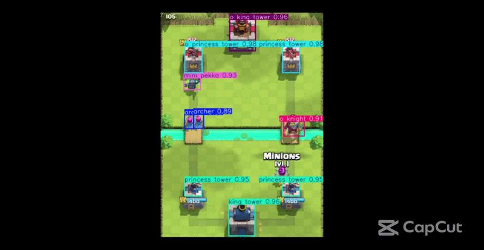

# Project Argus

A self-directed computer vision project exploring troop detection and game automation in Clash Royale, built by **Srijan Kumar Samrat**.

The repository contains a custom-trained YOLO11s detector, OpenCV processing for recorded gameplay, and a separate Python/ADB emulator-control prototype. The actuator currently selects cards randomly and deploys them at predefined positions. Connecting detections to deployment decisions is a planned next step.

## Demo



## Current components

| Component | Current implementation |
| --- | --- |
| Vision | YOLO11s detection and OpenCV visualization on recorded gameplay in [Test.py](src/Vision/Test.py). |
| Emulator control | A separate [Actuator.py](src/Actuator.py) prototype using ADB, random card selection, and predefined deployment positions. |
| Training | A configurable [Train.py](src/Vision/Train.py) script using Ultralytics and PyTorch. |
| Planned integration | Passing vision outputs to a decision-making and deployment loop. |

## Dataset and model

- **Dataset:** [Roboflow version 6](https://universe.roboflow.com/srijan-80rmd/cr_dataset/6).
- **Dataset summary:** 270 source frames, expanded to 508 annotated frames through augmentation.
- **Published checkpoint:** [models/best.pt](models/best.pt), a YOLO11s model with **24 class labels** in its saved metadata. Labels include troops, towers, and spells, with separate labels for some opposing units.
- **Training configuration:** 100 epochs and an input image size of 512 pixels.

The validation screenshot lists **16 classes present in that validation set**. This differs from the checkpoint's total of 24 labels; the displayed results do not establish performance for the other eight classes.

## Validation results

The recorded results are shown in the [validation screenshot](docs/Screenshot%202026-04-05%20201717.png). The mAP values also match the metrics saved in the published checkpoint.

| Metric or setting | Recorded value |
| --- | --- |
| mAP50 | 0.986 |
| mAP50–95 | 0.769 |
| Validation images | 16 |
| Annotated object instances | 125 |
| Classes represented in validation | 16 |
| Model | YOLO11s, approximately 9.4 million parameters |
| Training | 100 epochs, image size 512 |
| Validation inference time | 5.8 ms per image |
| Preprocessing / postprocessing | 0.5 ms / 1.0 ms per image |
| Hardware | NVIDIA GeForce RTX 4050 Laptop GPU |
| Recorded software | Python 3.13.3, Ultralytics 8.4.30, PyTorch 2.11.0+cu128 |

mAP50 measures detection performance at an intersection-over-union threshold of 0.50; mAP50–95 averages across thresholds from 0.50 to 0.95. These are validation metrics, not a guarantee that the same proportion of future detections will be correct. See the [Ultralytics metric definitions](https://docs.ultralytics.com/guides/yolo-performance-metrics/).

The validation set is small. Broader evaluation on unseen gameplay is needed to assess generalization. The timing above measures validation image processing on the stated GPU, not the response time or frame rate of a complete game-playing system.

## Getting started

These steps run the **recorded-video detection demonstration**. The original run used Python 3.13. A desktop environment is needed for the OpenCV display window.

1. Clone the repository and enter its directory:

   ```bash
   git clone https://github.com/Gonenza9090/Clash-Royale-Computer-Vision-Bot.git
   cd Clash-Royale-Computer-Vision-Bot
   ```

2. Install the Python dependencies, preferably in a virtual environment:

   ```bash
   python -m pip install -r requirements.txt
   ```

   For NVIDIA GPU execution, install the matching CUDA-enabled PyTorch build using the [official PyTorch instructions](https://pytorch.org/get-started/locally/).

3. Configure [src/Vision/Test.py](src/Vision/Test.py):
   - Replace the model-path placeholder with `model = YOLO("models/best.pt").to(device)`.
   - Set `video_path` to your recorded gameplay video. A source video is not included; `demo.gif` is a preview.
   - Adjust `frame = frame[65:795, 695:1225]` for the arena region in your video's resolution, or remove the crop to process the full frame. Incorrect crop bounds can produce an empty image.
   - For CPU execution, change `half=True` to `half=False` in `model.predict`. The recorded GPU benchmark does not describe CPU performance.

4. Run from the repository root:

   ```bash
   python src/Vision/Test.py
   ```

Press **Space** to pause and another key to resume; press **Q** during playback to quit.

## Optional emulator-control prototype

[src/Actuator.py](src/Actuator.py) is independent of the detector. It uses `pure-python-adb` (imported as `ppadb`), which is included in `requirements.txt`. The Android SDK Platform Tools `adb` executable must be installed separately.

1. Enable ADB in your emulator and start the ADB server with `adb start-server`.
2. If necessary, connect to the emulator's configured ADB address with `adb connect <host:port>`. Confirm that the intended emulator is listed by `adb devices`; the script selects the first connected device.
3. Adjust the hard-coded card and deployment coordinates for your emulator resolution.
4. Run `python src/Actuator.py`. It starts sending input immediately after connecting; press **Ctrl+C** to stop.

## Training configuration

To use [src/Vision/Train.py](src/Vision/Train.py), obtain the dataset export and set the `data` argument to its `data.yaml`. Place the pretrained `yolo11s.pt` weights in the repository root, or update `model_path`. The script currently selects CUDA device `0`; change the device setting if needed for your environment. Then run `python src/Vision/Train.py`.

## Next steps

- Connect vision outputs to deployment decisions.
- Evaluate on a larger, more varied validation set covering all model classes.
- Replace hard-coded paths and screen coordinates with configurable inputs.

## Notes on use

This is an educational project. Automating a game can break its terms of service, so do not run it on a live or ranked account. It is not affiliated with Supercell, and the game and its artwork belong to their owners.

## About

Built during a self-directed gap year to explore computer vision, machine learning, and robotics.
